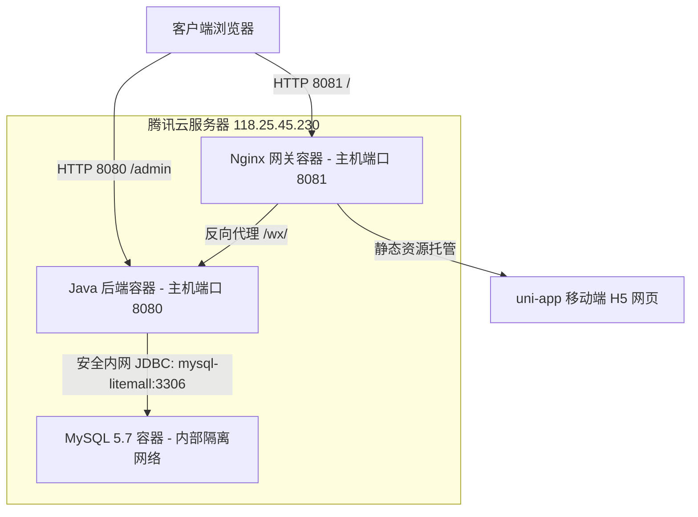

# Litemall 腾讯云服务器 Docker Compose 部署文档

本文档详细记录了基于 Docker Compose 将 Litemall 项目（MySQL数据库、Java Spring Boot 后端、Vue 运营管理后台、uni-app 移动端 H5 商城）完整部署到腾讯云 CentOS 服务器（主机别名：`my-tencent-118`，公网 IP：`118.25.45.230`）的架构设计、目录规划、访问方式及运维操作指南。

---

## 🏗️ 1. 部署架构设计与容器拓扑

为了确保企业演示时具备极佳的加载速度、零跨域限制（CORS）以及防爆破安全保障，系统采用三容器分布式网络拓扑，由 Docker Compose 一键编排并挂载内部网桥互联：



### 🔌 端口映射与安全隔离设计
1. **主机端口 `8081` (Nginx 静态网关 + 接口代理)**:
   * **功能**: 静态托管编译产出的 uni-app Vue 3 移动 H5 资源。
   * **代理**: 将前端调用的相对路径 `/wx/` API 自动透明代理至 `http://litemall:8080/wx/`。这保证了 H5 端调用 API 时免去硬编码 IP 的限制，且在多端混合部署时绝对不会产生浏览器的跨域拦截问题。
2. **主机端口 `8080` (Spring Boot API 后端 + 网页后台)**:
   * **功能**: 接收并处理 API 业务逻辑，同时在根目录 `/` 下直接托管已经编译嵌入的 **Vue 运营管理后台 (litemall-admin)**。
3. **私有网络端口 `3306` (MySQL 5.7 容器数据库)**:
   * **功能**: 负责数据的持久化存储，并预先载入了完整的初始商品数据。
   * **安全策略**: **不在宿主机暴露任何公网端口 (即去掉 `3306:3306` 映射)**。只有运行在同一个容器虚拟局域网的 `litemall` 容器可通过 `mysql-litemall:3306` 进行访问，彻底杜绝了外部恶意扫描和爆破攻击的隐患，同时也避免了与您服务器上现有运行的其他 MySQL 实例争抢端口。

---

## 📂 2. 服务器目录结构规划 (`~/litemall`)

所有部署相关的文件都妥善保存在您服务器的普通用户根目录 `~/litemall/` 下，文件结构定义极其严谨清晰：

```
~/litemall/
├── docker-compose.yml       # 多容器编排定义文件
├── nginx/
│   └── nginx.conf           # Nginx 静态托管及 API 反向代理配置文件
├── h5/                      # uni-app 编译生成的 Web H5 静态资源目录
├── litemall/
│   ├── litemall.jar         # Spring Boot 核心执行包（已内置前端 Admin 后台静态文件）
│   ├── application.yml      # Java 后端外部生产环境配置文件（已匹配容器内数据库地址）
│   └── logs/                # 容器卷挂载的后端实时日志输出目录（log.log / error.log）
└── db/
    └── init-sql/
        └── litemall.sql     # 合并后的数据库建表与初始业务数据 SQL 脚本
```

---

## 📱 3. 客户演示与访问指南

您可直接向客户提供以下公开入口以进行多维度功能体验：

### 📱 入口一：移动端 H5 手机商城 (基于 uni-app)
*   **访问链接**: [http://118.25.45.230:8081/](http://118.25.45.230:8081/)
*   **浏览建议**: 引导客户使用智能手机或在电脑上开启 **Chrome F12 手机模拟器** 浏览，能获得原生的 App 级视效。
*   **演示账号**: `user123`
*   **演示密码**: `user123`
*   **特色体验**:
    *   极具现代设计感、遵循 **Outfit 字体家族与磨砂玻璃微动效** 的轻奢主页。
    *   商品多级分类、高档筛选列表、高响应度模糊搜索联想下拉框。
    *   支持实时购物车增减、规格参数选择、快递地址维护、优惠券领用、以及模拟支付闭环流程。

### 💻 入口二：商城运营管理后台 (Admin Panel)
*   **访问链接**: [http://118.25.45.230:8080/](http://118.25.45.230:8080/)
*   **演示账号**: `admin123`
*   **演示密码**: `admin123`
*   **特色体验**:
    *   监控商城整体订单趋势图与用户活跃画像。
    *   管理手作商品的上架信息、详情图文、工期 lead_time 属性。
    *   处理客户模拟退款、售后申请及订单发货流程。

### ⚙️ 入口三：后端 REST API 通信健康性自检
*   **访问链接**: [http://118.25.45.230:8081/wx/home/index](http://118.25.45.230:8081/wx/home/index)
*   **功能**: 用于确认 Nginx 是否已在 8081 端口正确握手后端并读出数据库内容。正常情况下应当响应包含广告、品类、热门商品的完整 JSON 结构（`{"errno":0,"errmsg":"成功"}`）。

---

## 🛠️ 4. Docker Compose 常用运维指令速查

如需对服务器上的服务进行启停、重启或更新，请先通过终端 SSH 登录您的腾讯云服务器：
```bash
ssh my-tencent-118
```
随后切换至部署目录：
```bash
cd ~/litemall
```

使用以下命令进行集群维护：

*   **⚡ 查看所有容器状态与端口健康度**:
    ```bash
    docker compose ps
    ```
*   **⚡ 追踪查看后端 Java 容器的输出日志**:
    ```bash
    docker compose logs -f litemall
    ```
*   **⚡ 启动整套商城系统集群 (后台驻留模式)**:
    ```bash
    docker compose up -d
    ```
*   **⚡ 重启整套商城容器集群**:
    ```bash
    docker compose restart
    ```
*   **⚡ 停止并销毁当前容器集群 (不丢弃持久化的本地数据目录)**:
    ```bash
    docker compose down
    ```
*   **⚡ 查看 Nginx 容器的访问日志以定位调用问题**:
    ```bash
    docker compose logs -f nginx
    ```

---

## 🔬 5. 常见运维保障与问题排查

1. **容器挂载卷说明**:
   * 数据库数据持久化在 `~/litemall/db/data/` 目录中，在容器执行 `down` 后重新 `up` 时，数据**绝不会丢失**。
   * 后端运行产生的日志将自动写入挂载的 `~/litemall/litemall/logs/log.log` 中，方便直接在宿主机进行归档和监控。
2. **应用重新打包与热更新**:
   * 若修改了 uni-app 前端代码，在本地重新构建 `npm run build:h5` 后，仅需通过 SCP 将 `dist/build/h5/` 下的文件拷贝覆盖云服务器的 `~/litemall/h5/` 目录即可，**无需重启容器**，浏览器刷新即刻呈现最新视觉。
   * 若修改了后端 Java 代码，仅需将本地打包的 `litemall.jar` 拷贝覆盖 `~/litemall/litemall/litemall.jar` 并执行 `docker compose restart litemall` 即可快速生效。
